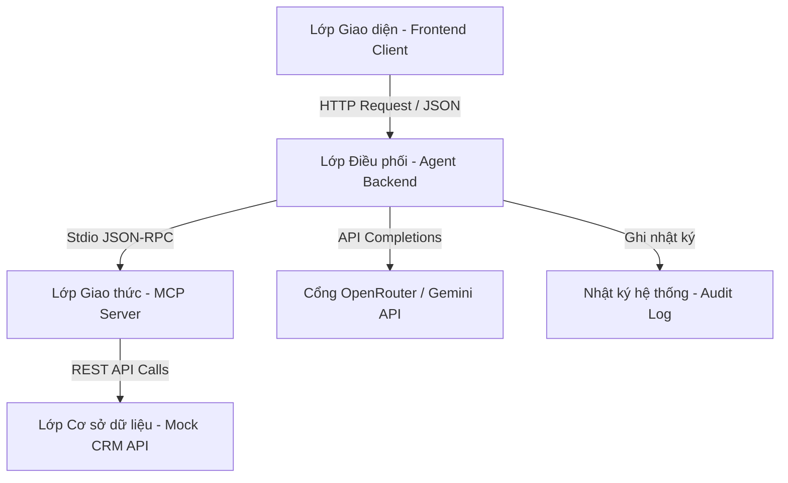
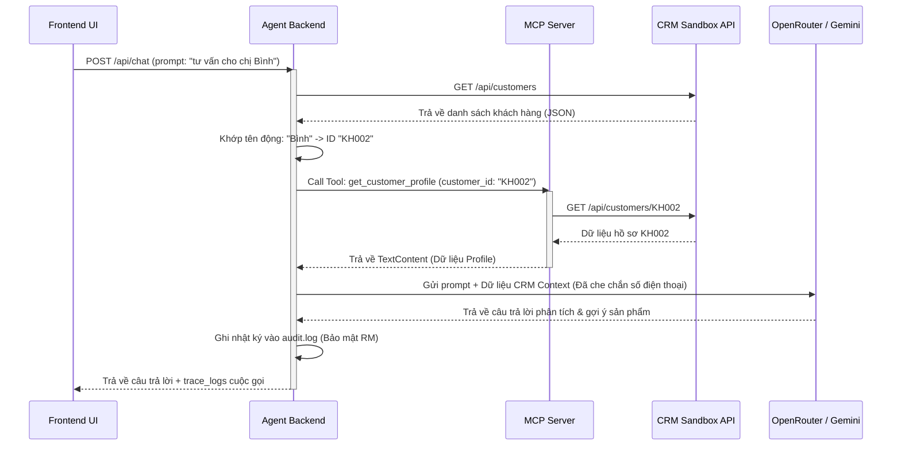

# TÀI LIỆU KIẾN TRÚC KỸ THUẬT (TECHNICAL ARCHITECTURE)
## Hệ thống AI Co-Pilot Dashboard hỗ trợ Chăm sóc Khách hàng & Bán chéo (CRM Co-Pilot)

Tài liệu này thuyết minh kiến trúc kỹ thuật của hệ thống AI Co-Pilot tích hợp giao thức MCP kết nối động cơ sở dữ liệu CRM Sandbox.

---

### 1. Sơ đồ Kiến trúc Tổng quan (Architecture Overview)

Hệ thống được thiết kế theo cấu trúc **4 lớp** độc lập và bảo mật:

1.  **Lớp Giao diện (Frontend Client - Port 8000)**: Phát triển bằng Vanilla HTML5, CSS3 Glassmorphism và Javascript. Giao diện trực quan chia thành 3 khu vực:
    *   Bảng cảnh báo đáo hạn & đề xuất bán chéo bên trái.
    *   Khung chat tương tác RM Co-Pilot ở giữa.
    *   Console hiển thị log cuộc gọi (Trace Console) bên dưới để Ban giám khảo dễ dàng đối chiếu dữ liệu.
    *   Popup quản lý cấu hình dữ liệu (Tải lên file JSON sản phẩm, mẫu, khách hàng).
2.  **Lớp Điều phối (Agent Backend - Port 8000)**: Viết bằng FastAPI (Python). Chịu trách nhiệm nhận câu hỏi từ Client, khớp tên khách hàng động, khởi chạy MCP client kết nối stdio với MCP server, và điều phối cuộc gọi API đến OpenRouter (`nvidia/nemotron-3-ultra-550b-a55b:free` hoặc Gemini) để sinh câu trả lời.
3.  **Lớp Giao thức kết nối (MCP Server)**: Thực thi theo chuẩn **Model Context Protocol (MCP)** của Anthropic/Google. MCP Server đóng gói các API CRM thành các công cụ nghiệp vụ (Tools):
    *   `get_savings_due_this_week`
    *   `get_customer_profile`
    *   `get_active_campaigns`
    *   `query_product_knowledge`
    *   `get_email_template`
4.  **Lớp CSDL & API Sandbox (Mock CRM - Port 8001)**: Đóng vai trò là hệ thống lõi giả lập của Bank A, cung cấp dữ liệu khách hàng, cơ hội bán hàng, lịch sử tương tác và tiếp nhận ghi nhận thông tin bản nháp email từ AI gửi xuống.

---

### 2. Sơ đồ Luồng Dữ liệu Động (Dynamic Data Flow Sequence)

Dưới đây là quy trình xử lý khi RM gửi một câu hỏi nghiệp vụ (Ví dụ: *"tư vấn cho chị Bình"*):

---

### 3. Cơ chế Bảo mật và Tuân thủ (Security & Compliance - PDPA)

*   **Ẩn danh dữ liệu (Data Masking)**: Số điện thoại và Email khách hàng trước khi chuyển tiếp sang MCP Server để gửi lên AI hoàn toàn được ẩn danh hóa dưới dạng `091***888` và `khang.le***@gmail.com`. Điều này đảm bảo dữ liệu khách hàng không bị lộ lọt ra mô hình AI công cộng, tuân thủ 100% **Luật bảo vệ dữ liệu cá nhân PDPA Việt Nam**.
*   **Nhật ký kiểm toán (Audit Logging)**: Mọi thao tác tư vấn, soạn thảo email và tác vụ CRM của RM đều được ghi nhận thời gian thực vào tệp tin [audit.log](file:///c:/Users/Admin/Downloads/Tool_Check/AI_Agent/agent_backend/audit.log) giúp dễ dàng tra cứu nguồn gốc và trách nhiệm nghiệp vụ.
