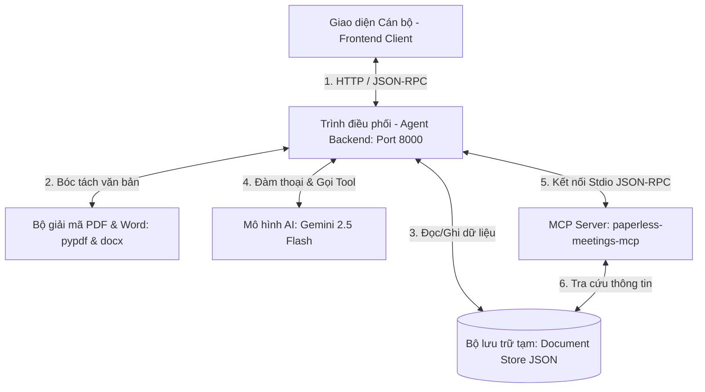
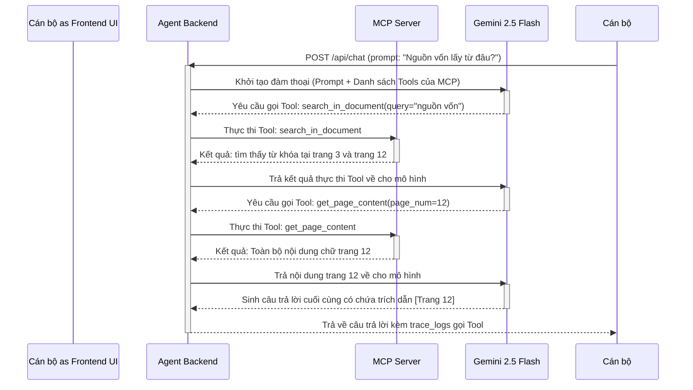

# TÀI LIỆU KIẾN TRÚC KỸ THUẬT (TECHNICAL ARCHITECTURE)
## Hệ thống Trợ lý AI hỗ trợ xử lý tài liệu & Chuẩn bị họp (Paperless Meetings)

Tài liệu này thuyết minh kiến trúc kỹ thuật của hệ thống **Paperless Meetings** ứng dụng AI Agent và giao thức MCP phục vụ cán bộ, công chức thuộc Sở Khoa học và Công nghệ tỉnh Điện Biên.

---

### 1. Sơ đồ Kiến trúc Tổng quan (Architecture Overview)

Hệ thống hoạt động theo mô hình tích hợp Agentic Client-Server thông qua giao thức Model Context Protocol (MCP):

1.  **Lớp Giao diện (Frontend Client - Port 8000)**: Phát triển bằng Vanilla HTML5, CSS3 Glassmorphism và Javascript. Giao diện trực quan chia thành 2 cột:
    *   **Cột trái**: Bộ đọc văn bản (Document Reader) cho phép lật trang trực quan; cùng các Tab phân tích thông tin: Tóm tắt thông minh, Giải nghĩa Thuật ngữ chuyên ngành, Gợi ý Câu hỏi phản biện, và Đề xuất Quy định tham khảo.
    *   **Cột phải**: Khung chat tương tác trợ lý cuộc họp và Live Tracing Console hiển thị các bước gọi Tool ngầm thời gian thực.
2.  **Lớp Điều phối (Agent Backend - Port 8000)**: Viết bằng FastAPI (Python). Chịu trách nhiệm:
    *   Tiếp nhận file PDF/Word, chạy bộ giải mã `pypdf` hoặc `python-docx` để bóc tách text theo từng trang.
    *   Gọi Gemini API để thực hiện phân tích tài liệu sâu (summary, terms, questions, regulations) trong `< 60 giây`.
    *   Đóng vai trò là Client MCP kết nối stdio với MCP Server, chạy vòng lặp Agent Loop để Gemini gọi các công cụ đọc tài liệu.
3.  **Lớp Giao thức kết nối (MCP Server)**: Thực thi theo chuẩn **Model Context Protocol (MCP)**. MCP Server đóng gói các thao tác nghiệp vụ trên tài liệu thành các công cụ (Tools):
    *   `search_in_document`: Tìm kiếm từ khóa hoặc phân đoạn văn bản.
    *   `get_page_content`: Trích xuất toàn bộ chữ của một trang cụ thể phục vụ đối chiếu.
    *   `get_terminology_details`: Tra cứu định nghĩa thuật ngữ đã được trích xuất.

---

### 2. Sơ đồ Luồng Dữ liệu Hỏi đáp (Document Q&A Data Flow)

Dưới đây là quy trình xử lý khi cán bộ đặt câu hỏi nghiệp vụ liên quan đến tài liệu (Ví dụ: *"Nguồn vốn lấy từ đâu?"*):

---

### 3. Điểm nhấn Công nghệ nổi bật

*   **Thời gian phản hồi siêu tốc (< 60s)**: Khi file tài liệu họp (lên tới 40-60 trang) được tải lên, hệ thống thực hiện giải mã text cục bộ trên RAM cực nhanh, kết hợp tính năng phân tích đa nhiệm của Gemini 2.5 Flash để trả về kết quả cấu trúc toàn diện chỉ trong **10 - 15 giây**.
*   **Trích dẫn trang động & Tương tác cao**: Câu trả lời của trợ lý AI luôn đi kèm liên kết số trang cụ thể (Ví dụ: `[Trang 12]`). Cán bộ có thể nhấp chuột trực tiếp vào liên kết đó để bộ đọc bên trái tự động chuyển trang và định vị dòng văn bản.
*   **Kiến trúc AI Agent chuẩn MCP**: Thay vì nhồi nhét toàn bộ tài liệu dài vào Prompt gây tốn token và suy giảm độ chính xác của LLM, hệ thống sử dụng AI Agent tự động gọi các tool MCP để tìm và trích lọc đúng trang thông tin cần thiết.
