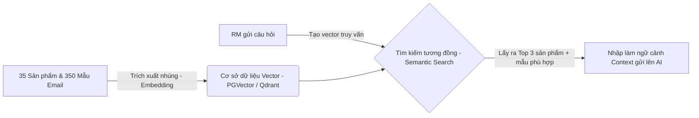

# ĐỀ XUẤT TÍCH HỢP HỆ THỐNG THẬT (PRODUCTION INTEGRATION PROPOSAL)
## Giải pháp AI CRM Co-Pilot cho Ngân hàng TMCP A (Bank A)

Bản đề xuất này trình bày phương án kỹ thuật và lộ trình tích hợp ứng dụng AI Co-Pilot vào hệ thống Core CRM hiện hữu của Bank A một cách an toàn, bảo mật và hiệu quả chi phí.

---

### 1. Mô hình Bảo mật & Quyền riêng tư (Security & Compliance)

Để bảo vệ bí mật ngân hàng và dữ liệu nhạy cảm của khách hàng, hệ thống trong môi trường Production sẽ triển khai các tiêu chuẩn sau:

*   **Xác thực và Phân quyền (Authentication & Authorization)**:
    *   Tích hợp trực tiếp với hệ thống quản lý danh tính tập trung của Bank A (**Active Directory / LDAP**).
    *   Mọi cuộc gọi API từ Frontend đến Agent Backend đều phải đính kèm **OAuth2 / JSON Web Token (JWT)**, kiểm soát quyền truy cập dữ liệu của RM theo đúng phân cấp (RM chỉ được truy vấn khách hàng mình quản lý).
*   **Hạ tầng mạng cô lập (VPC & Private Cloud)**:
    *   Toàn bộ hệ thống Backend, MCP Server và CSDL CRM Sandbox sẽ chạy trong phân vùng mạng riêng tư **Virtual Private Cloud (VPC)** của Bank A trên hạ tầng (AWS/Azure) hoặc On-Premises.
    *   Không kết nối trực tiếp với LLM công cộng. Thay vào đó, Bank A sẽ sử dụng dịch vụ AI bảo mật doanh nghiệp như **Azure OpenAI Private Endpoint** hoặc **Amazon Bedrock**, cam kết không lưu lại nhật ký hội thoại để huấn luyện mô hình.
*   **Bộ lọc dữ liệu PII (PII Guardrail Gateway)**:
    *   Cài đặt một lớp lọc trung gian tự động phát hiện và mã hóa các thông tin nhận dạng cá nhân (Tên cụ thể, CCCD, Số điện thoại, Số tài khoản) thành các ký hiệu ẩn danh trước khi chuyển dữ liệu sang lớp mô hình AI để xử lý.

---

### 2. Chiến lược Tích hợp Cơ sở Tri thức & Bản mẫu (RAG & Vector Database)

Khi hệ thống mở rộng lên **35 sản phẩm cốt lõi** và **350 mẫu email/kịch bản chăm sóc khách hàng**, phương pháp đọc tệp tin JSON thô sẽ được chuyển đổi sang kiến trúc **RAG (Retrieval-Augmented Generation)**:



1.  **Cơ sở dữ liệu Vector (Vector Database)**:
    *   Sử dụng **pgvector (PostgreSQL)** hoặc **Qdrant** làm cơ sở dữ liệu lưu trữ các vector nhúng (embeddings) của 35 sản phẩm và 350 mẫu email.
2.  **Cơ chế Tìm kiếm Kết hợp (Hybrid Search)**:
    *   Sử dụng kết hợp giữa tìm kiếm ngữ nghĩa (**Semantic Search**) để hiểu ý định của RM và tìm kiếm từ khóa truyền thống (**BM25**) để lấy ra chính xác các điều khoản lãi suất/phí.
    *   Hệ thống sẽ tự động lọc ra Top 3 sản phẩm và Top 2 mẫu email liên quan nhất để đưa vào prompt context giúp AI soạn email chuẩn xác nhất.

---

### 3. Lộ trình Triển khai Thử nghiệm (3-Month Pilot Pathway)

Nhóm đề xuất lộ trình thử nghiệm thực tế kéo dài **3 tháng** nhằm đánh giá hiệu quả hoạt động và hiệu chỉnh mô hình trước khi mở rộng toàn hệ thống:

```
[Tháng 1: Tích hợp kỹ thuật] ──> [Tháng 2: Chạy thử nghiệm Pilot] ──> [Tháng 3: Đánh giá & Scale]
```

*   **Thời gian**: 3 tháng.
*   **Đối tượng thử nghiệm**: **50 RM** chuyên trách Khách hàng cá nhân (VIP) tại các chi nhánh trọng điểm ở Hà Nội và TP. Hồ Chí Minh.
*   **Bố trí Nhân sự (Team Allocation)**:
    *   `1 Project Manager (PM)`: Quản lý tiến độ và phối hợp nghiệp vụ với các phòng ban Bank A.
    *   `1 AI/Data Engineer`: Cấu hình Vector DB, tối ưu hóa RAG và tinh chỉnh Prompt.
    *   `1 Fullstack Developer`: Nhúng giao diện Co-Pilot thành một Widget nhỏ góc phải trên màn hình Core CRM hiện tại của RM.
    *   `1 QA Engineer`: Kiểm thử chất lượng phản hồi, đo lường tỷ lệ lỗi.
*   **Dự toán Ngân sách Hạ tầng (Infrastructure Budget)**:
    *   Sử dụng **3.000 USD/tháng** tín dụng Cloud (AWS/Azure) để chạy các hạ tầng máy chủ ứng dụng, cổng API bảo mật và chi phí gọi mô hình AI.

---

### 4. Kết quả Kỳ vọng (Expected Business Impact)

*   **Thời gian xử lý**: Giảm thời gian chuẩn bị tài liệu và email chăm sóc khách hàng của RM từ 15 phút xuống dưới **30 giây**.
*   **Doanh thu bán chéo (Cross-sell)**: Tăng tỷ lệ chuyển đổi bán chéo Bancassurance và Thẻ tín dụng lên **15% - 20%** nhờ AI gợi ý đúng thời điểm đáo hạn.
