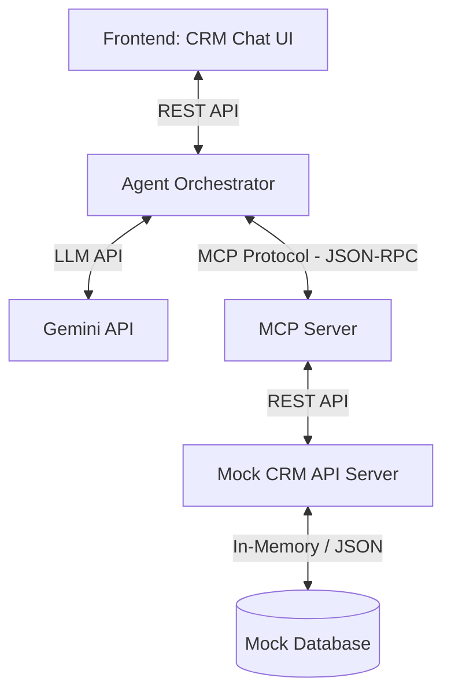

# Bank A CRM - AI Co-Pilot (VIC 2026 - Challenge #16)

Dự án này là giải pháp **AI Agent cho CRM** phục vụ cho **Relationship Manager (RM) của Bank A** tại cuộc thi **Vietnam Innovation Challenge 2026 (Track Đổi Mới Sáng Tạo)**.

Ứng dụng giúp tự động hóa hoạt động chăm sóc khách hàng, soạn thảo thư điện tử (email) và kịch bản cuộc gọi cá nhân hóa dựa trên dữ liệu CRM thật thông qua giao thức **Model Context Protocol (MCP)**.

---

## 1. Sơ đồ Kiến trúc & Luồng dữ liệu

Hệ thống hoạt động theo mô hình tích hợp phi tập trung (Microservices-ready):



* **Module 1: Mock CRM (`mock_crm`)**: Giả lập hệ thống Sandbox API của Bank A (Port 8001) với các endpoints: `GET /customers`, `GET /opportunities`, `GET /interactions`, `POST /draft-email`, `POST /call-script`.
* **Module 2: MCP Server (`mcp_server`)**: Kết nối vào CRM, đóng gói dữ liệu thành các công cụ (Tools) nghiệp vụ và cung cấp cho LLM thông qua kênh kết nối stdio.
* **Module 3: Agent Orchestrator (`agent_backend`)**: Đóng vai trò là Client MCP kết nối LLM (Gemini) với MCP Server. Server này cũng có cơ chế **fallback cục bộ (Local Rules)** đề phòng sự cố LLM mất mạng, và ghi chép nhật ký bảo mật **Audit Log**.
* **Module 4: Frontend UI (`frontend`)**: Giao diện Dashboard và Chatbox cho RM (Port 8000) với phong cách **Glassmorphism Dark Theme**, có tính năng hiển thị trace log thời gian thực.

---

## 2. Hướng dẫn Cài đặt & Chạy ứng dụng

### Bước 1: Cài đặt thư viện phụ thuộc
Đảm bảo bạn đã cài đặt Python 3.10 trở lên. Chạy lệnh sau để cài đặt các package cần thiết:
```bash
pip install -r requirements.txt
```

### Bước 2: Cấu hình biến môi trường
Tạo file `.env` từ file mẫu:
```bash
copy .env.example .env
```
Mở file `.env` và điền khóa API của Gemini:
```env
GEMINI_API_KEY=your_gemini_api_key_here
```
*(Nếu không có API Key, hệ thống sẽ tự động chuyển sang cơ chế **Local Banking Fallback** để bạn chạy thử nghiệm mượt mà không cần mạng).*

### Bước 3: Khởi chạy hệ thống
Chạy script tự động để khởi động tất cả các phân hệ song song:
```bash
python run.py
```

Sau khi khởi chạy thành công:
* **Giao diện làm việc của RM**: Mở [http://127.0.0.1:8000](http://127.0.0.1:8000) trên trình duyệt.
* **Tài liệu API Sandbox**: Truy cập [http://127.0.0.1:8001/docs](http://127.0.0.1:8001/docs) để xem Swagger UI của CRM.

---

## 3. Các kịch bản thử nghiệm chấm điểm (Test Scenarios)

Bạn có thể chạy thử trực tiếp bằng cách nhập câu hỏi tự nhiên hoặc click vào các nút gợi ý nhanh (Quick Chips) ở dưới chân khung chat:

1. **Kịch bản 1: Nhắc việc tiết kiệm đến hạn**
   * **Câu hỏi**: *"Nhắc tôi những khách hàng có tiết kiệm đến hạn trong tuần này"*
   * **Kỳ vọng**: AI Agent gọi MCP lọc ra danh sách khách hàng đến hạn. Sau đó, RM yêu cầu soạn thảo, AI tự động sinh email và kịch bản cuộc gọi điền sẵn số tiền, ngày đáo hạn. Bấm nút **[Ghi nhận CRM]** sẽ lưu nháp trực tiếp vào cơ sở dữ liệu và Dashboard sẽ tự động cập nhật trạng thái mới.
2. **Kịch bản 2: Bán chéo bảo hiểm liên kết tín dụng**
   * **Câu hỏi**: *"Khách Nguyễn Văn An có cơ hội mua bảo hiểm gì phù hợp không?"*
   * **Kỳ vọng**: AI tự động chuyển context từ Khách hàng sang module Opportunity và Lịch sử tương tác để đọc dữ liệu (Anh An có khoản vay mua nhà 2 tỷ, chưa mua bảo hiểm) -> Đề xuất gói "Trọn Đời An Tâm" kèm tỷ lệ chuyển đổi chốt deal thành công là 40%.

---

## 4. Điểm nhấn Kỹ thuật nổi bật

* **Tuân thủ PDPA**: Mọi thông tin nhạy cảm của khách hàng hiển thị trên giao diện và truyền tải qua LLM đều được che giấu (ví dụ: Số điện thoại ẩn dưới dạng `091***888`).
* **Audit Trail**: Toàn bộ hoạt động gọi AI và thực thi Tool đều được ghi chép minh bạch tại `agent_backend/audit.log`.
* **Traceability**: Khung Terminal bên trái hiển thị trực tiếp các API đang gọi và MCP Tool đang chạy thời gian thực để chứng minh hệ thống hoạt động thật, không hardcode.
