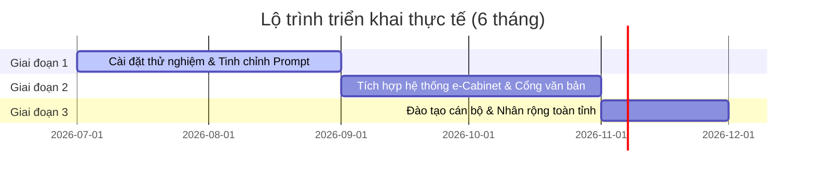

# LỘ TRÌNH TRIỂN KHAI & MÔ HÌNH HỆ THỐNG (DECK SLIDE 1-PAGE)
## Hệ thống Trợ lý AI Họp Không Giấy Tờ - UBND Tỉnh Điện Biên

---

### 🏛️ MÔ HÌNH XỬ LÝ (PROCESSING MODEL)
```
[Tài liệu cuộc họp PDF/Word] ➔ [Bộ parser tách trang tự động] ➔ [Lưu trữ cục bộ bảo mật]
                                                                        │
                                                                        ▼
[Trích dẫn động trang Q&A]  ◀─── [Agent Loop với MCP Tools]  ◀─── [Gemini 2.5 Flash API]
```
*   **Giải mã văn bản cực nhanh**: Tách chữ theo trang cục bộ bằng Python (`pypdf` / `python-docx`), hoàn thành xử lý sơ bộ tài liệu 40+ trang trong `< 3 giây`.
*   **Phân tích song song đa nhiệm**: Gemini sinh tóm tắt cấu trúc 4 chiều, trích lọc 10+ thuật ngữ hành chính và tạo 5 câu hỏi phản biện trong `< 15 giây`.
*   **AI Agent chuẩn MCP**: LLM tự động sử dụng các MCP tools để truy vết, trích lọc thông tin theo trang thay vì gửi toàn bộ tài liệu hành chính lên đám mây, tối ưu hóa băng thông và bảo mật thông tin.

---

### 📂 NGUỒN DỮ LIỆU TÍCH HỢP (DATA SOURCES)
1.  **Tài liệu cuộc họp nội bộ**: Báo cáo tình hình KT-XH, tờ trình phê duyệt, dự thảo quy hoạch, phương án đầu tư công của các sở ban ngành gửi trình UBND tỉnh.
2.  **Kho dữ liệu Văn bản QPPL Quốc gia**: Hệ thống Luật, Nghị định của Chính phủ, Thông tư của Bộ ngành liên quan để đối chiếu tính pháp lý.
3.  **Văn bản điều hành của địa phương**: Các Quyết định, Nghị quyết, Chỉ thị của Tỉnh ủy và UBND tỉnh Điện Biên làm cơ sở thực tiễn.

---

### 🗺️ LỘ TRÌNH TRIỂN KHAI THỰC TẾ TẠI UBND TỈNH ĐIỆN BIÊN
Hệ thống được thiết kế để tích hợp trực tiếp vào ứng dụng **Phòng họp không giấy tờ (e-Cabinet)** của tỉnh Điện Biên theo lộ trình **3 giai đoạn**:



#### 📍 Giai đoạn 1: Triển khai thử nghiệm & Huấn luyện cục bộ (Tháng 1 - Tháng 2)
*   Cài đặt hệ thống trên máy chủ dùng riêng của Sở Khoa học & Công nghệ tỉnh Điện Biên.
*   Nạp bộ từ điển thuật ngữ hành chính đặc thù của địa phương; tối ưu prompts tóm tắt và sinh câu hỏi phản biện theo đúng văn phong công sở hành chính.

#### 📍 Giai đoạn 2: Tích hợp hệ thống & Kiểm toán Bảo mật (Tháng 3 - Tháng 4)
*   Liên kết API với hệ thống **Phòng họp không giấy tờ (e-Cabinet)** có sẵn của UBND tỉnh Điện Biên để tự động đồng bộ tài liệu họp của cán bộ khi có lời mời họp.
*   Triển khai MCP server trên mạng truyền số liệu chuyên dùng của các cơ quan Đảng, Nhà nước (mạng WAN dùng riêng), thực hiện kiểm toán bảo mật dữ liệu an toàn thông tin.

#### 📍 Giai đoạn 3: Đào tạo & Phổ biến Nhân rộng (Tháng 5 - Tháng 6)
*   Tổ chức các lớp tập huấn kỹ năng chuẩn bị họp và tương tác trợ lý AI cho lãnh đạo UBND tỉnh, lãnh đạo các Sở, Ban, Ngành và cán bộ chuyên viên.
*   Nghiệm thu thực tế và nhân rộng mô hình ra toàn bộ các huyện, thị xã trên địa bàn tỉnh Điện Biên.
